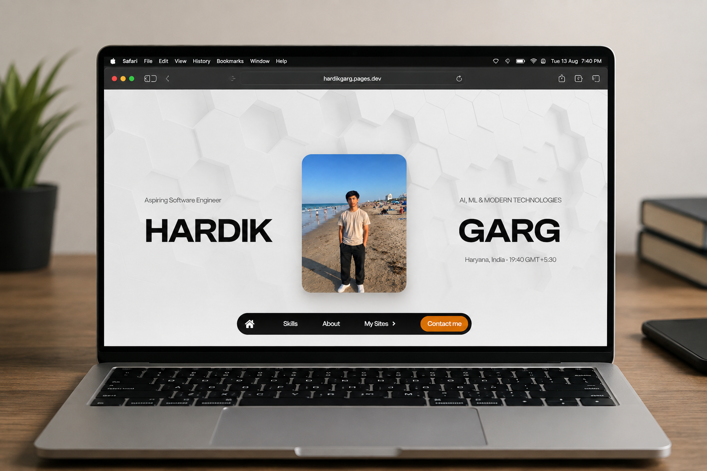

<div align="center">

# ⚡ hardikgarg.dev

### Personal Portfolio • Software Engineering • AI & Technology

<p>
  <a href="https://hardikgarg.pages.dev">
    
  </a>
  <a href="https://github.com/hardikgargok">
    
  </a>
</p>

<p>
  
  
  
  
  
</p>

</div>

---

## 👋 Hello, I'm Hardik

I'm an aspiring **Software Engineer** interested in building useful products with **software, Artificial Intelligence, Machine Learning, and data-driven technologies**.

I enjoy taking an idea from a simple concept and turning it into a working application.

My current journey focuses on:

* 🤖 Artificial Intelligence & Machine Learning
* 🐍 Python Development
* 💻 Software Engineering
* 🌐 Web Development
* 📊 Data Analysis
* 🗄️ SQL
* 🧠 Problem Solving & DSA
* 🚀 Building practical projects

> **Learn → Build → Improve → Repeat.**

---

## 🌐 About This Project

**hardikgarg.dev** is my personal developer portfolio and the central place where I showcase my work, skills, projects, and learning journey.

The website is designed to be:

* ⚡ Fast
* 🎨 Modern
* 📱 Responsive
* 🧩 Interactive
* 🌙 Developer-focused
* 🚀 Easy to maintain

Rather than being just a resume on the web, the goal is to make this portfolio a **living representation of my growth as a developer**.

---

## ✨ Highlights

| Feature          | Description                                  |
| ---------------- | -------------------------------------------- |
| 🎨 Modern UI     | Clean and developer-focused interface        |
| 📱 Responsive    | Designed for desktop, tablet and mobile      |
| ⚡ Lightweight    | No unnecessary frameworks or dependencies    |
| 🧩 Interactive   | Smooth interactions and dynamic elements     |
| 🚀 Fast          | Simple static architecture for quick loading |
| 💼 Portfolio     | Projects, skills and developer information   |
| 🔗 Links         | Easy access to GitHub and other profiles     |
| 🛠️ Maintainable | Simple HTML, CSS and JavaScript structure    |

---

## 🛠️ Technology Stack

### Frontend

<p>


</p>

### Programming & Data

<p>


</p>

### Areas of Interest

```text
Artificial Intelligence
Machine Learning
Data Analysis
Software Development
Web Development
Automation
Problem Solving
```

---

## 📂 Project Structure

```text
hardikgarg.dev/
│
├── assets/
│   └── images, icons and other resources
│
├── index.html
├── styles.css
├── script.js
│
└── README.md
```

The project intentionally uses a simple structure so the website remains easy to understand, modify and deploy.

---

## 🚀 Run Locally

### 1. Clone the repository

```bash
git clone https://github.com/hardikgargok/hardikgarg.dev.git
```

### 2. Open the project

```bash
cd hardikgarg.dev
```

### 3. Start a local server

```bash
python -m http.server 5173
```

### 4. Open in your browser

```text
http://localhost:5173
```

---

## 🌍 Live Website

### → [HardikGarg](https://hardikgarg.pages.dev)

The latest version of the portfolio is available online.

---

## 🖼️ Preview

<p align="center">
  
</p>

---

## 🚀 Projects

Some of the projects I'm working on and exploring include:

### 🖊️ SketchFlow

A browser-based digital whiteboard concept focused on drawing, brainstorming and interactive visual work.

**Focus:** Web Development • Canvas • UI/UX

---

### 🤖 AI & Data Projects

I'm continuously exploring projects involving:

* Artificial Intelligence
* Machine Learning
* Python
* Data Analysis
* SQL
* Automation
* Intelligent applications

More projects will be added as they become production-ready.

---

## 🎯 Current Focus

```text
                    ┌─────────────────────┐
                    │   Software Engineer  │
                    └──────────┬──────────┘
                               │
              ┌────────────────┼────────────────┐
              │                │                │
              ▼                ▼                ▼
             AI/ML           Python           Web
              │                │                │
              └────────────────┼────────────────┘
                               │
                               ▼
                       Real-World Projects
                               │
                               ▼
                         Continuous Growth
```

Currently, I'm focused on becoming stronger in:

* 🧠 Data Structures & Algorithms
* 🐍 Advanced Python
* 🤖 AI & Machine Learning
* 📊 Data Analysis
* 🗄️ SQL
* 💻 Software Engineering
* 🌐 Modern Web Development

---

## 📈 Development Philosophy

I believe the best way to learn technology is to **build with it**.

```text
        Learn
          ↓
       Practice
          ↓
        Build
          ↓
       Break
          ↓
        Debug
          ↓
       Improve
          ↓
        Repeat
```

Every project is an opportunity to learn something new.

---

## 🗺️ Roadmap

### Completed

* [x] Create personal portfolio
* [x] Build responsive website
* [x] Add project showcase
* [x] Add developer-focused design
* [x] Deploy portfolio

### In Progress

* [ ] Add more real-world projects
* [ ] Improve animations and interactions
* [ ] Add detailed project case studies
* [ ] Improve accessibility
* [ ] Improve SEO
* [ ] Optimize performance

### Future

* [ ] Add technical blog
* [ ] Add project analytics
* [ ] Add interactive resume
* [ ] Add AI-powered portfolio features
* [ ] Add more open-source projects
* [ ] Build larger production applications

---

## 📊 GitHub Activity

<p align="center">


</p>

---

## 🧰 Tools I Use

<p align="center">


</p>

---

## 📫 Connect With Me

<p align="center">

<a href="https://hardikgarg.dev">

</a>

<a href="https://github.com/hardikgargok">

</a>

</p>

---

## ⭐ Support

If you like the project or find something useful here, consider giving the repository a ⭐.

Every star is appreciated!

---

## 📄 License

This project is maintained by **Hardik Garg**.

The source code and portfolio content are provided for personal and educational purposes.

---

<div align="center">

### 💻 Built with code, curiosity & continuous learning.

**hardikgarg.dev**

</div>
